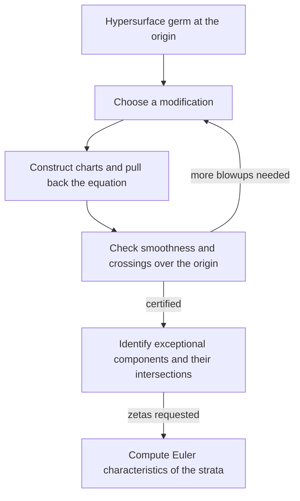

# How Atlas resolves a hypersurface germ

An embedded resolution gives a map under which the hypersurface and the
exceptional divisors have normal crossings over the origin. There are often
several ways to obtain such a map. For example, the plane cusp takes three
ordinary point blowups, while a hypersurface with a suitable Newton polyhedron
can be resolved directly from a fan. After choosing a modification, Atlas
checks the equations on its charts. [Work through the cusp](resolving-a-cusp.md)

This chapter describes `method="auto"`, the default at the prompt, in scripts,
on the command line and over HTTP. Its `charts` field describes the maps, and
its `atlas` field describes the regions used to check them and count
intersections. For a resolution by weighted blowups on quotient charts, use
`method="weighted"`. That method has its own certificate and output fields.
[Reading a resolution record](resolution-records.md) · [Weighted resolution](weighted-resolution.md)

## How Atlas chooses a modification

The input consists of a nonzero rational polynomial vanishing at the origin,
the ordered coordinates, and a choice of embedded or intrinsic resolution.
A particular family often admits a short construction. If its hypotheses
fail, the search moves on to a more general method. Any candidate must still
supply the charts and satisfy the checks for the requested mode.

### Structured inputs

| Geometry of the input | Construction |
| --- | --- |
| Smooth germ, or an embedded divisor already having normal crossings | The identity suffices. For an embedded singular germ in three to eight coordinates, Atlas checks for coordinate powers or smooth factors through the origin with independent differentials. |
| Singular plane curve | Blow up points and follow the branches through the new charts until the requested crossings hold. [Plane blowups](../native/plane.cpp) |
| A-series surface singularity | Try the chain of surface charts before the ordinary-point test. [Surface chains](../native/chain.cpp) |
| Smooth projectivized tangent cone | Try the ordinary blowup of the origin. [Ordinary points](../native/ordinary.cpp) |
| Diagonal surface or binomial | Try a fan adapted to the diagonal surface, or coordinate blowups for the binomial. [Diagonal surface fans](../native/toricfan.cpp) · [Binomial charts](../native/binomial_fan.cpp) |

The ordinary engine accepts two to eight variables, at most 4,096 expanded
terms and total degree at most 128. Outside that range a nonzero linear part
can still certify a smooth germ. After reaching a plane worker limit in
exhaustive search the solver skips the binomial shortcut. For a repeated
input factor, embedded mode can resolve the reduced support and recover the
original multiplicities from its transforms. Intrinsic mode requires a
reduced germ. [Dispatch and size checks](../engine/resolve.py) · [Recovering multiplicities](../engine/weighted_record.py)

### Bounded centre proofs

A natural centre to try is the reduced singular locus. Consider
$f=A^2-TB^2$, where $A=x+y+z$, $B=x-y$ and $T=z$. In these linear
coordinates the Jacobian ideal is $(A,TB,B^2)$, whose radical $(A,B)$ defines
a line. Blowing up this line gives two charts.

| Chart | Pullback of $f$ | Strict transform |
| --- | --- | --- |
| $A=Bu$ | $B^2(u^2-T)$ | $u^2=T$ |
| $B=Av$ | $A^2(1-Tv^2)$ | $Tv^2=1$ |

The equations agree on the overlap $uv=1$. In the first chart $B$ is a
coordinate independent of $u,T$, so the smooth strict transform crosses the
exceptional divisor $B=0$ transversely. In the second, $A$ plays the same
role. Compare $(y-x^2)^2-z^5$. Its reduced singular locus is also smooth,
but on the blowup chart $y-x^2=zu$ the strict equation is still the cusp
$u^2=z^3$. Here a further modification is needed. [Centre and chart calculations](../native/ideal.cpp)

Both search policies can try this construction for inputs in three to eight
variables with four to 128 terms. The reduced Jacobian locus must be a smooth
complete intersection through the origin, of positive dimension and
codimension at least two. Atlas saturates each chart by its pivot before
checking the transforms. An embedded polynomial-graph centre can directly
certify a single exceptional divisor. Other presentations and intrinsic
requests require component analysis. This trial has a 100 ms budget.
[Candidate limits](../engine/reduced_centre.py) · [Component analysis](../engine/general_resolution.py)

Exhaustive search also tries two cheaper embedded proofs first. A small fan
may certify the first monomial ideal candidate. For a pencil $H(x,y)+zK(x,y)$
of binary homogeneous forms of equal degree 2–15, the second shortcut applies
when $H$ is a multiple of a power of a noncoordinate rational linear form
and $K$ is nonzero at its projective root. After ruling out the preceding
Newton candidates, the verifier tests the identity, origin and coordinate-line
centres in order. The shortcut succeeds when only the third centre works.
[Bounded trials](../engine/newton_trials.py) · [Pencil test](../native/resolution_candidate.cpp)

### Quick search

Use `--quick` for a bounded attempt. The search tries an eligible regular
Newton modification, including available coordinate changes and repairs of
failed crossings. For unresolved singularities in three variables it can
start blowups from the origin. In four to eight variables that attempt is
limited to the repeated-tangent rule. The final attempt tests priority ideals.
The CLI worker has 55 seconds. If it exhausts its budget, its diagnostic
reports an inconclusive calculation. [Newton modifications](../engine/newton_backend.py) · [Origin blowups](../engine/origin_backend.py) · [Ideal search](../engine/general_resolution.py)

### Exhaustive search

The CLI and session default to exhaustive search. Atlas increases the time
available to an undecided candidate and retries it. On eligible singular
inputs in three to eight variables it can search for a Newton modification,
point blowups and an ideal blowup concurrently. In the usual schedule Newton
has a two-second head start. Its verified chart data can be reused directly.
Outside the parallel case, eligible inputs try Newton before general ideal
enumeration. HTTP requests that omit a policy first try quick search and may
return a background exhaustive job. [Search schedule](../engine/resolution_search.py) · [HTTP policy](../engine/app.py)

One tangent-cone test changes this order. Suppose an embedded ternary input
has a higher-order term and initial form $cL^d$, with $d\ge2$ and all three
coefficients of $L$ nonzero. Its axial intercepts all have degree $d$. In
the coordinate choices available to this search the Newton modification is
the ordinary origin blowup. The exceptional plane meets the strict transform
along a repeated line whose intersection with the dense torus is a curve.
Newton's finite-point repair cannot resolve that curve. For degree at most
16, at most 128 terms and 64-bit rational numerators and denominators, Atlas
can detect this case and start origin blowups immediately. Ideal certification
joins on failure or after 250 ms. [Tangent test](../native/resolution_candidate.cpp) · [Newton repair](../engine/newton_repair.py)

### Workers and deadlines

Each solve runs in its own process so that a deadline or interruption can
stop it. On Linux, interactive and HTTP sessions can fork workers from a
preloaded engine. A one-shot CLI solve starts an interpreter. If no fork
server is available, a single-threaded CPU solver can fork its own search
workers. Each starts with fresh verification state. Changed engine sources,
changes to startup-only settings, or multithreading can require a fresh
interpreter. Helper programs for plane curves, fans and graph charts use the
same deadlines in forked mode. [Fork server](../engine/fork_server.py) · [Native helper processes](../engine/native_process.py)

When enough processors are available the other workers may start alongside
Newton, holding their answers until its head start ends. Otherwise a forked
worker receives its candidate when its turn begins. A parallel certificate
search preloads one verifier and starts a spare if a proof is undecided or
times out. [Exhaustive worker coordination](../engine/exhaustive_resolution.py)

## Constructing and verifying charts

For a **Newton modification**, each maximal cone of a regular fan gives an
affine chart. The rays specify a monomial substitution. Removing the
exceptional monomial from the pullback gives the strict-transform equation.
[Newton chart construction](../engine/newton_backend.py)

For a **smooth blowup**, each chart uses one generator of the centre as a
pivot. The new coordinates include the ratios of the remaining generators
to this one, as in the line example above. For a general **ideal blowup**,
the verifier saturates these graph equations by the pivot to recover the
closure of the graph away from the exceptional divisor. Adding the pulled-back
hypersurface equation and saturating again gives the strict transform.
Comparing the boundary components on overlaps determines which local pieces
glue. [Smooth centres](../engine/local_blowups.py) · [Graph charts](../engine/graph_record.py) · [Boundary gluing](../engine/general_resolution.py)

### Where the resolution decisions run

For canonical point and curve blowups, Atlas uses the invariant of Bierstone
and Milman to choose a smooth centre while the strict transform is singular.
On eligible affine hypersurface charts it computes the invariant and centre
by successive restriction to hypersurfaces of maximal contact. When a surface
in a threefold has become smooth, the curves cut out on it by the exceptional
divisors determine the remaining blowups. [Bierstone and Milman, *Desingularization algorithms I. Role of exceptional divisors*, Theorem 1.14 (2003)](https://arxiv.org/abs/math/0207098) · [Centre calculation](../native/centre_affine_maximum.cpp) · [Surface step](../native/surface_centre_choice.cpp)

| Charts | What the native verifier checks |
| --- | --- |
| Canonical blowups | Each stage computes strict transforms, exceptional orders and charts. It checks which new charts meet the fibre and where crossings still fail. For intersections it uses the exceptional ideals, equations of the fibre, and exclusions on each chart. [Blowup stage](../native/canonical_blowup.cpp) · [Chart incidence](../native/owned_chart_incidence.cpp) |
| Ideal blowups | The graph equations give the strict transform, projection and exceptional orders. Decomposition over the rationals or a marked number field, followed by comparison on overlaps, identifies the geometric components. [Graph verification](../native/graph_replay.cpp) · [Wide inputs](../native/graph_wide.cpp) · [Component projections](../native/component_projection.cpp) |
| Newton charts | The fan verifier checks the substitutions, pullbacks, face domains and crossings. Torus sections give incidence and the faces of each cell. On a degenerate stratum the saturated Jacobian and a finite-locus test guide the repair. [Fan verification](../native/fan_verification.cpp) · [Torus sections](../native/torus_sections.cpp) · [Newton repair](../native/newton_repair.cpp) |
| Saved charts | The verifier recovers the projection, chart domains and exceptional ideals from the saved equations, then glues components and computes the requested invariants. [Projection coefficients](../native/projection_coefficients.hpp) · [Gluing](../native/chart_gluing.cpp) |

## What the record certifies

Two affine charts of one blowup overlap. For instance, the two charts of a
plane point blowup both contain all nonzero finite slopes of its exceptional
line. To count that line once, one chart can take all finite slopes and the
other the single missing point. The `atlas` field makes such assignments
precise. Each piece specifies its projection, ambient equations, components,
origin fibre and the region and exclusions it owns.

An identity, plane, ideal-blowup, point or fan chart can have a dedicated
verifier. A monomial construction can also supply its verified atlas directly.
When these routes decline, Atlas reconstructs the charts and performs the
general checks. [Monomial constructions](../native/monomial_resolution.cpp) · [Verifier selection](../engine/strata.py) · [General chart checks](../engine/atlas.py)

To compare divisor pieces on affine charts, Atlas equates their original coordinates and saturates away from the exceptional divisors to obtain the closure of the overlap. From this graph it can recover the rational coordinate changes in both directions. Two pieces glue when these changes are regular at their generic points, carry each generic point to the other, and respect the loci removed from both charts. A meeting confined to a smaller closed subset therefore leaves the components distinct. [Overlap construction](../engine/atlas_gluing.py) · [Native coordinate comparisons](../native/primary_decomposition.cpp)

Embedded mode verifies normal crossings of the total transform on the owned fibre and computes incidence for ambient exceptional divisors. Intrinsic mode verifies the smooth strict transform and computes incidence on that transform. If an intrinsic atlas cannot supply embedded strata for the requested zetas, Atlas resolves the same polynomial in embedded mode and can store the verified `embedded_companion.atlas`. [Mode and companion handling](../engine/resolve.py) · [Chart conventions](resolution-records.md#chart-and-complex-conventions)

Both zetas use the same compactly supported Euler characteristics of disjoint strata. A’Campo’s formula uses the open strata on individual components and their multiplicities. The topological zeta function uses all strata, their multiplicities and the orders of the pulled-back volume form. [Native monodromy](../native/monodromy.cpp) · [Native topological zeta](../native/zeta.cpp) · [Formulas and cusp values](resolution-records.md#local-monodromy-zeta-function)

## Replaying a saved resolution

Replay starts from the saved equation and charts and skips the search for a modification. The `recompute-dual-complex` command recomputes incidence in the saved mode. Zeta replay checks embedded strata, using the saved companion when present. Some older records without reconstructible chart ownership can supply their archived certified numerical data and strata. A record that cannot establish the required embedded strata yields an unavailable zeta. [Replay a saved cusp](resolution-records.md#save-and-replay-the-cusp) · [Incidence replay](../engine/resolution_complex.py) · [Strata replay and archive fallback](../engine/strata.py) · [Session zeta replay](../engine/session_values.py)
