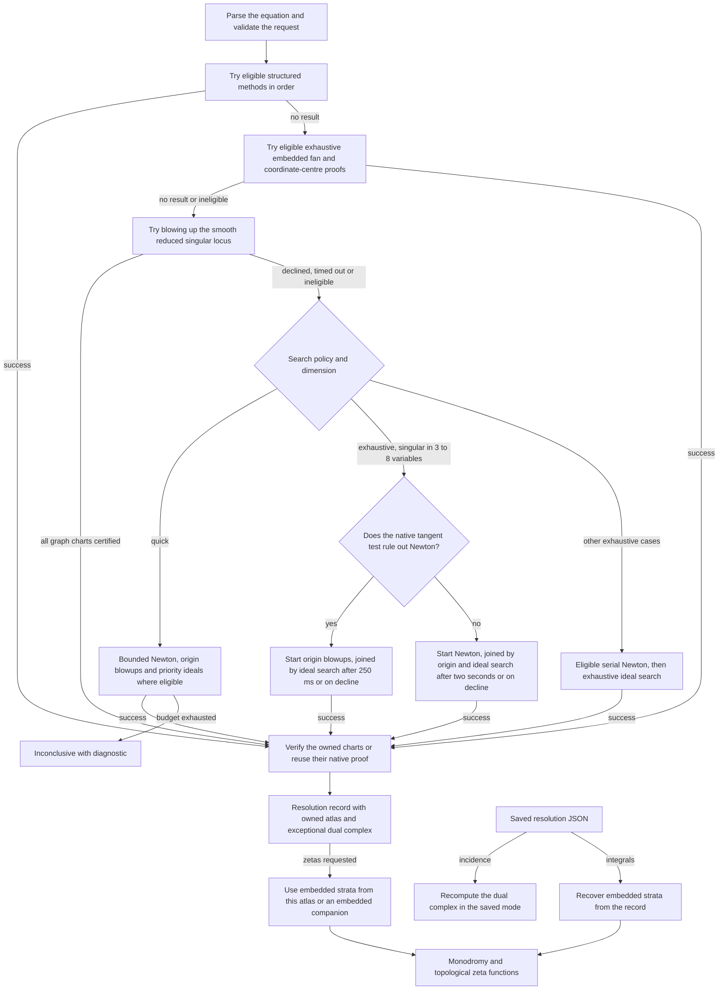

# How Atlas resolves a hypersurface germ

A request specifies a polynomial over the rationals, its ordered coordinates, and a resolution mode. Atlas resolves the germ at the origin. The `charts` field describes the modification. The `atlas` field records the pieces of those charts used to verify the answer and count strata over the origin. [Request and dispatch](../engine/resolve.py) · [Atlas serialization](../engine/atlas.py)

The CLI, prompt, scripts and HTTP workers call the same solver. An invalid variable list, a zero equation or a hypersurface missing the origin is an input error. Exceeding a quick parsing limit gives an inconclusive result. [Session entry point](../engine/session.py) · [Worker](../engine/worker.py) · [Input parser](../engine/polynomial.py)

Each resolution still runs in a process of its own, in its own session, so it can be stopped at a deadline or on interruption. On Linux the prompt, scripts and the HTTP server fork these workers from a preloaded engine instead of starting an interpreter. The fork server imports the solver and loads the native libraries but never computes. Until it is ready, and in a one-shot `atlas resolve`, which finishes before such a server could be ready, workers start an interpreter as before. A worker forked from it requests its search lanes from the same server, and the server stops a requester's children when that requester exits. A solver without a server, such as the one-shot `atlas resolve`, forks its search lanes from itself when it has a single thread and computes on the CPU. Each lane leads its own session, keeps only its standard streams and its coordinator pipe, and starts from fresh replay and face-check contexts. Otherwise each lane starts an interpreter. It declines requests that change interpreter settings fixed at startup and requests made after the engine sources or native build changed, and the caller then starts the interpreter. The native helper programs (plane curves, Newton fans, face and graph checks) also run in forked copies of the calling solver, with the same timeouts and exit status as the programs. [Fork server](../engine/fork_server.py) · [Helper entries](../engine/native_process.py)



## How Atlas chooses a modification

1. For an embedded singular germ in three to eight variables, Atlas first checks for a divisor with normal crossings at the origin. Coordinate powers or smooth factors through the origin with independent differentials certify the identity map. Singular plane curves go to the plane blowup algorithm. A smooth germ outside the size range of the ordinary engine gets the identity from its nonzero linear part. [Dispatcher](../engine/resolve.py) · [Normal crossings test](../engine/monodromy_special.py) · [Plane resolver](../native/plane.cpp)
2. Within the ordinary engine's range (two to eight variables, at most 4,096 terms, total degree at most 128), singular three-variable inputs first try the A-series surface chain. The ordinary engine handles smooth germs and tests for a smooth projective tangent cone. In three variables, a diagonal Newton surface is the next candidate. If still unresolved, two-term inputs in two to eight variables can try coordinate blowups, except after an exhaustive plane-worker limit. [Surface chains](../engine/chain_backend.py) · [Ordinary points](../engine/native_backend.py) · [Diagonal surfaces](../engine/toric_backend.py) · [Binomials](../engine/binomial_backend.py)
3. **Exhaustive search**, the CLI and session default, first tries two bounded embedded proofs where eligible. A small fan can certify the first monomial ideal candidate. For a ternary pencil `H(x,y) + z*K(x,y)`, the next test requires binary homogeneous forms of equal degree 2–15, with `H` a scalar times a power of a noncoordinate rational linear form and `K` nonzero at its projective root. After certifying that the preceding Newton candidates cannot resolve the germ, an isolated graph worker tests the identity, origin and coordinate-line centres in their scheduled order. The third must pass and both predecessors must fail. [Bounded trials](../engine/newton_trials.py) · [Pencil test and size limits](../native/resolution_candidate.cpp) · [Graph worker](../native/graph_verify.cpp)
4. **Both search policies** can then try the reduced singular locus. The C++ kernel forms the Jacobian ideal `(f, ∂f/∂x₁, …, ∂f/∂xₙ)` and computes its radical. If that radical presents a smooth complete intersection through the origin, of positive dimension and codimension at least two, its generators define a candidate blowup. The kernel saturates each standard open and checks the transforms and crossings. Embedded mode can certify a single exceptional divisor when the centre is a polynomial graph over free coordinates. Other centres and intrinsic requests go through geometric component analysis. Eligibility includes three to eight variables and four to 128 input terms. The native trial has a 100 ms deadline. A failed proof or budget limit returns control to the existing search. [Native centre and chart proofs](../native/ideal.cpp) · [Trial limits](../engine/reduced_centre.py) · [Record construction](../engine/general_resolution.py)
5. **Quick search** uses bounded parsing and a 55-second CLI worker deadline. Eligible inputs try a regular Newton modification, including coordinate changes, monomial ideals or repairs of failed crossings. An unresolved singular three-variable input can try blowups from the origin. In four to eight variables the quick origin attempt is limited to the repeated-tangent rule. The final search tests priority blowup ideals with bounded effort. Exhausting the quick search yields an inconclusive record. [CLI deadline](../engine/resolve_cli.py) · [Newton](../engine/newton_backend.py) · [Origin blowups](../engine/origin_backend.py) · [Ideal search](../engine/general_resolution.py)
6. In the exhaustive worker search, Atlas can rule out Newton on embedded ternary inputs of total degree at most 16, with at most 128 terms and 64-bit rational numerators and denominators. The test requires a higher-order term and a lowest-degree part exactly equal to `c*L^d`, with `d ≥ 2` and all three coefficients of the linear form `L` nonzero. All axial intercepts then have degree `d`. The only coordinate choice in Atlas's Newton search gives the ordinary origin blowup. Its exceptional plane meets the strict transform along the repeated line `L=0`. That line meets the dense torus in a curve, beyond the scope of Newton's finite-point repair. With this proof, Atlas starts the origin-blowup worker immediately and starts ideal certification if that worker declines, fails, or is still running after 250 ms. [Native tangent test](../native/resolution_candidate.cpp) · [Newton repair](../engine/newton_repair.py) · [Worker coordination](../engine/exhaustive_resolution.py)
7. In the usual parallel search Newton gets a two-second head start. Origin blowups and general ideal certification join as soon as Newton gives no result or its head start expires. When the lanes are forked, from the preloaded engine or from the solver, and the process may use a processor for each of them, the later lanes start with Newton, but their answers wait until Newton answers or its head start expires. Newton keeps its priority. With fewer processors, lanes forked from the solver are created with Newton and receive their request when they join. A Newton lane that certifies a regular monomial modification returns its verified atlas, and the solver attaches it without verifying the same charts again unless zetas need its integrals. A certificate search that starts alongside a live worker warms one verifier. An undecided proof or timeout enables its spare for later candidates. The first successful worker supplies the charts for verification. Outside the parallel case, eligible inputs try Newton serially before general ideal enumeration. The exhaustive scheduler increases allowances and retries undecided candidates. For HTTP requests with no search policy, the server tries quick first and can return a background exhaustive job. [Candidate schedule](../engine/resolution_search.py) · [HTTP policy](../engine/app.py)

For example, set `A=x+y+z`, `B=x-y` and `T=z`. The equation `A²−TB²` has Jacobian ideal `(A, TB, B²)`, whose radical is the line `(A,B)`. On the two opens of its blowup, the strict transforms are `u²−T=0` for `u=A/B` and `1−Tv²=0` for `v=B/A`. They agree where `uv=1`. A smooth centre alone cannot certify this outcome. For `(y−x²)²−z⁵`, the reduced singular locus is also smooth, but the chart with pivot `z` has strict equation `u²−z³=0` and the search continues. [Positive and negative regression cases](../tests/test_reduced_centre_geometry.py)

When a producer reports a component repeated through the origin, embedded mode can resolve the reduced support and lift each original multiplicity back to the charts. Intrinsic resolution requires a reduced germ. [Weighted divisors](../engine/weighted_record.py)

For a **Newton modification**, each maximal cone of a regular fan gives an affine chart. Its rays specify a monomial substitution for the original coordinates, and factoring the exceptional monomial from the pullback gives the strict-transform equation. **Successive smooth blowups** use a generator of the centre as pivot on each standard open, express the other generators as ratios times that pivot, and transform the strict ideal and existing divisors there. For an **ideal blowup**, saturating the graph equations by the pivot gives the ambient chart ideal. Adjoining the pulled-back hypersurface equation to the ambient chart ideal and saturating that ideal by the pivot gives the strict transform. Comparing boundary components on overlapping opens determines which labels glue. [Newton chart construction](../engine/newton_backend.py) · [Blowups of smooth centres](../engine/local_blowups.py) · [Graph reconstruction](../engine/graph_record.py) · [Boundary gluing](../engine/general_resolution.py)

### Where the resolution decisions run

| Stage | Native computation |
| --- | --- |
| Canonical point or curve blowup | At each blowup the kernel classifies the failing charts together. On an eligible affine hypersurface chart it computes the whole maximal-contact descent and returns the invariant and the ordered centre ideal. On a smooth surface presented as a rational graph it can certify a boundary curve directly from its traces, multiplicities and ownership. Other charts go through the general frame and surface procedures, each in one native call per chart. The blowup of a whole stage (strict transforms, exceptional orders and data, elimination of graph coordinates, retained charts) and the presence and crossing tests of the new charts are one native call each. Rings beyond the packed kernel take the step-by-step route through the same operations. [Affine descent](../native/centre_affine_maximum.cpp) · [Surface centre](../native/surface_centre_choice.cpp) · [General centre search](../native/centre_search.cpp) · [Frame and surface procedures](../native/centre_maximum.cpp) · [Blowup stage](../native/canonical_blowup.cpp) |
| Exceptional intersections on canonical charts | For each chart the kernel receives the exceptional ideals, fibre, ownership equations and removed loci together. It tests intersections, counts the owned geometric and rational components, and returns the unresolved strata to the general component verifier. Saved canonical charts use the same computation. [Owned chart incidence](../native/owned_chart_incidence.cpp) · [Component verification](../engine/geometric_components.py) |
| Ideal-blowup charts | The graph verifier checks the strict transform, its crossings, the exceptional orders and the projection. Component decomposition over rational and marked fields and the comparisons on chart overlaps determine which pieces glue. [Graph replay](../native/graph_replay.cpp) · [Unpacked graph verification](../native/graph_wide.cpp) · [Geometric projections](../native/component_projection.cpp) |
| Newton charts | The regular fan gives the substitution. One native call verifies a fresh fan: the owned supports, pullbacks and projections, region generators, exceptional data shared by the charts, crossings on each owned fibre and the torus-section plan. [Fan verification](../native/fan_verification.cpp) The native torus and surface kernels compute component incidence and identify the faces of each cell. When a torus stratum is degenerate, the repair kernel uses its saturated Jacobian and a finite-locus test to choose the repair. [Surface incidence](../native/fan_surface.cpp) · [Torus sections](../native/torus_sections.cpp) · [Newton repair](../native/newton_repair.cpp) |
| Verification of saved charts | The verifier reconstructs chart maps, ownership and exceptional ideals from the saved equations. General gluing uses native component and face decisions. The zeta kernels use the multiplicities, volume orders and Euler characteristics of the verified strata. [Projection coefficients](../native/projection_coefficients.hpp) · [Gluing](../native/chart_gluing.cpp) · [Zeta computation](../native/monodromy.cpp) |

## What the record certifies

Each owned chart specifies its projection, ambient equations, components, origin fibre, and the region and exclusions that assign points to that chart. These assignments prevent counting an overlap twice. The dispatcher can reuse a native monomial construction that already verified the same record. Otherwise it tries dedicated verifiers for identity, plane, ideal-blowup, point and fan charts, then reconstructs the general atlas when those verifiers decline. [Attachment](../engine/resolve.py) · [Native monomial construction](../native/monomial_resolution.cpp) · [Verifier dispatch](../engine/strata.py) · [General chart checks](../engine/atlas.py)

To compare divisor pieces on affine charts, Atlas equates their original coordinates and saturates away from the exceptional divisors to obtain the closure of the overlap. From this graph it can recover the rational coordinate changes in both directions. Two pieces glue when these changes are regular at their generic points, carry each generic point to the other, and respect the loci removed from both charts. A meeting confined to a smaller closed subset therefore leaves the components distinct. [Overlap construction](../engine/atlas_gluing.py) · [Native coordinate comparisons](../native/primary_decomposition.cpp)

Embedded mode verifies normal crossings of the total transform on the owned fibre and computes incidence for ambient exceptional divisors. Intrinsic mode verifies the smooth strict transform and computes incidence on that transform. If an intrinsic atlas cannot supply embedded strata for the requested zetas, Atlas resolves the same polynomial in embedded mode and can store the verified `embedded_companion.atlas`. [Mode and companion handling](../engine/resolve.py) · [Chart conventions](resolution-records.md#chart-and-complex-conventions)

Both zetas use the same compactly supported Euler characteristics of disjoint strata. A’Campo’s formula uses the open strata on individual components and their multiplicities. The topological zeta function uses all strata, their multiplicities and the orders of the pulled-back volume form. [Monodromy](../engine/monodromy.py) · [Topological zeta](../engine/topological.py)

## Replaying a saved resolution

```sh
./atlas resolve 'x^2-y^2*(z+t)' --vars x,y,z,t --compute cpu --monodromy --json > resolution.json
./atlas recompute-dual-complex resolution.json
./atlas monodromy resolution.json --json
```

Replay starts from the saved equation and charts and skips the search for a modification. The `recompute-dual-complex` command recomputes incidence in the saved mode. Zeta replay checks embedded strata, using the saved companion when present. Some older records without reconstructible chart ownership can supply their archived certified numerical data and strata. A record that cannot establish the required embedded strata yields an unavailable zeta. [Incidence replay](../engine/resolution_complex.py) · [Strata replay and archive fallback](../engine/strata.py) · [Session zeta replay](../engine/session_values.py)
