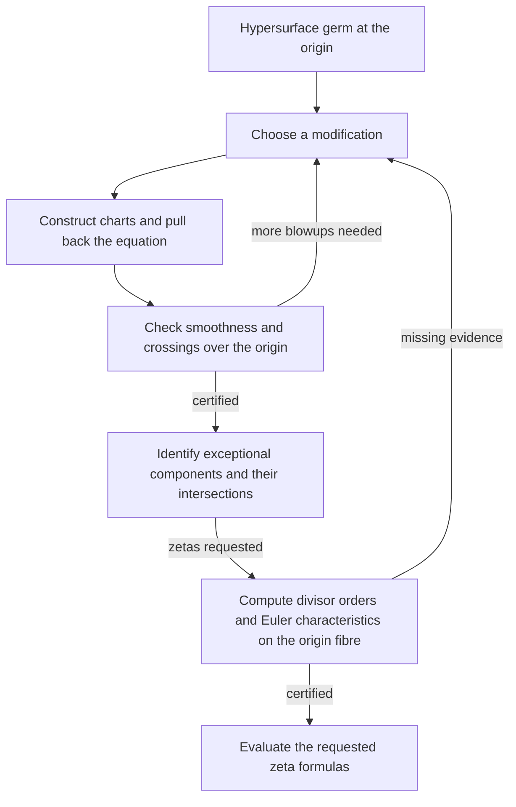

# How Atlas resolves a hypersurface germ

An embedded resolution gives a map under which the hypersurface and the
exceptional divisors have normal crossings over the origin. There are often
several ways to obtain such a map. For example, the plane cusp takes three
ordinary point blowups, while a hypersurface with a suitable Newton polyhedron
can be resolved directly from a fan. After choosing a modification, Atlas
checks the equations on its charts. [Work through the cusp](../tutorial/resolving-a-cusp.md)

This chapter describes `method="auto"`, the default at the prompt, in scripts,
on the command line and over HTTP. Its `charts` field describes the maps, and
its `atlas` field describes the regions used to check them and count
intersections. For a resolution by weighted blowups on quotient charts, use
`method="weighted"`. That method has its own certificate and output fields.
[Reading a resolution record](resolution-records.md) · [Weighted resolution](weighted-resolution.md)

## How Atlas chooses a modification

The input consists of a nonzero rational polynomial vanishing at the origin,
the ordered coordinates, and a choice of embedded or intrinsic resolution.
A particular family often admits a short construction. If its hypotheses
fail, the search moves on to a more general method. Any candidate must still
supply the charts and satisfy the checks for the requested mode.

### Structured inputs

| Geometry of the input | Construction |
| --- | --- |
| Smooth germ, or an embedded divisor already having simple normal crossings | The identity suffices. Atlas recognizes coordinate powers times a unit, and its bounded factorization test recognizes smooth rational branches with independent differentials. For eligible equations in two active coordinates it also verifies two transverse conjugate branches over a quadratic field, including cylinders in up to eight ambient coordinates. [Conjugate plane branches](../../engine/plane_identity.py) |
| Singular plane curve | Blow up points and follow the branches through the new charts until the requested crossings hold. [Plane blowups](../../native/plane.cpp) |
| A-series surface singularity | Try the chain of surface charts before the ordinary-point test. [Surface chains](../../native/chain.cpp) |
| Smooth projectivized tangent cone | Try the ordinary blowup of the origin. [Ordinary points](../../native/ordinary.cpp) |
| Diagonal surface or binomial | Try a fan adapted to the diagonal surface, or coordinate blowups for the binomial. [Diagonal surface fans](../../native/toricfan.cpp) · [Binomial charts](../../native/binomial_fan.cpp) |
| Reduced central arrangement of four to twelve rational planes spanning three coordinates | Blow up the origin. Its exceptional plane carries the projective line arrangement. In embedded mode blow up the strict intersection lines whose directions have at least three incident planes. Intrinsic mode also separates each pair meeting at an ordinary double direction. [Arrangement charts and incidence](../../native/plane_arrangement.cpp) |

A surface can have a diagonal Newton face in nonlinear coordinates. For
`(x+y*z)^2+y^5+z^5`, the solver completes the square and uses the fan of
`X^2+y^5+z^5`. Each displayed chart composes its fan projection with
`x=X-y*z`. The certificate stores the coordinate and its polynomial offset
in `coordinate_translation`. Replay derives the offset again from the input
equation and verifies the projections. The quadratic translation fixes the
origin and has Jacobian determinant one, so it preserves the origin fibre
and volume orders. [Quadratic candidates](../../native/resolution_candidate.cpp)

A singular direction of the tangent cone rules out the ordinary-point criterion.
For example, $xyz(x+y+z)$ has a singular tangent direction $[1:0:0]$.
One blowup gives an embedded resolution. The four projective lines have
only transverse double intersections, and the exceptional plane supplies the
third transverse component there. [Four-line resolution](../../web/zoo-data/records/cone-four-lines.json)

For $xyz(x+y)$, three planes meet along the $z$-axis. After blowing up the
origin, the solver blows up the strict transform of that axis. The three
planes then meet its exceptional divisor at distinct directions.
[Four planes with a triple line](../../web/zoo-data/records/cone-d4-quartic.json)

A repair centre can contain several geometric points conjugate over the
rationals. Atlas follows each point through the repair charts and uses those
labels on intersections of exceptional divisors. For the Hesse triangle
with a quartic perturbation this gives one arm of the embedded tree for each
of the three nodes. For the cone over two tangent conics it gives one set
of exceptional divisors over each of their two points of tangency.
[Hesse triangle](../../web/zoo-data/records/hesse-triangle-quartic.json) · [Two tangent conics](../../web/zoo-data/records/quartic-face-plus.json)

The fast ordinary-point engine accepts two to eight variables, at most 4,096
expanded terms and total degree at most 128. Outside that range a nonzero
linear part can still certify a smooth germ, and the general ideal search
accepts arbitrary finite ambient dimension. After reaching a plane worker limit in
exhaustive search the solver skips the binomial shortcut. For a repeated
input factor, embedded mode can resolve the reduced support and recover the
original multiplicities from its transforms. Intrinsic mode requires a
reduced germ. Atlas checks whether the quotient by the squarefree part is
a unit at the origin, so repeated factors away from the germ are allowed.
The stopping test depends on the mode. For the cusp cylinder
$y^2-x^3=0$ in three-space, one ordinary blowup along the singular line
makes the strict transform smooth. Embedded resolution takes three ordinary
blowups to give the total divisor simple normal crossings.
[Dispatch and size checks](../../engine/resolve.py) · [Binomial charts](../../native/binomial_fan.cpp) · [Recovering multiplicities](../../engine/weighted_record.py)

### Bounded centre proofs

A natural centre to try is the reduced singular locus. Consider
$f=A^2-TB^2$, where $A=x+y+z$, $B=x-y$ and $T=z$. In these linear
coordinates the Jacobian ideal is $(A,TB,B^2)$, whose radical $(A,B)$ defines
a line. Blowing up this line gives two charts.

| Chart | Pullback of $f$ | Strict transform |
| --- | --- | --- |
| $A=Bu$ | $B^2(u^2-T)$ | $u^2=T$ |
| $B=Av$ | $A^2(1-Tv^2)$ | $Tv^2=1$ |

The equations agree on the overlap $uv=1$. In the first chart $B$ is a
coordinate independent of $u,T$, so the smooth strict transform crosses the
exceptional divisor $B=0$ transversely. In the second, $A$ plays the same
role. Compare $(y-x^2)^2-z^5$. Its reduced singular locus is also smooth,
but on the blowup chart $y-x^2=zu$ the strict equation is still the cusp
$u^2=z^3$. Here a further modification is needed. [Centre and chart calculations](../../native/ideal.cpp)

Both search policies can try this construction for inputs in three to eight
variables with four to 128 terms. The reduced Jacobian locus must be a smooth
complete intersection through the origin, of positive dimension and
codimension at least two. Atlas saturates each chart by its pivot before
checking the transforms. An embedded polynomial-graph centre can directly
certify a single exceptional divisor. Other presentations and intrinsic
requests require component analysis. This trial has a 100 ms budget.
[Candidate limits](../../engine/reduced_centre.py) · [Component analysis](../../engine/general_resolution.py)

Exhaustive search also tries two cheaper embedded proofs first. A small fan
may certify the first monomial ideal candidate. For a pencil $H(x,y)+zK(x,y)$
of binary homogeneous forms of equal degree 2–15, the second shortcut applies
when $H$ is a multiple of a power of a noncoordinate rational linear form
and $K$ is nonzero at its projective root. After ruling out the preceding
Newton candidates, the verifier tests the identity, origin and coordinate-line
centres in order. The shortcut succeeds when only the third centre works.
[Bounded trials](../../engine/newton_trials.py) · [Pencil test](../../native/resolution_candidate.cpp)

### Quick search

Use `--quick` for a bounded attempt. The search tries an eligible regular
Newton modification, including available coordinate changes and repairs of
failed crossings. For unresolved singularities in three variables it can
start blowups from the origin. In four to eight variables that attempt is
limited to the repeated-tangent rule. The final attempt tests priority ideals.
The CLI worker has 55 seconds. If it exhausts its budget, its diagnostic
reports an inconclusive calculation. [Newton modifications](../../engine/newton_backend.py) · [Origin blowups](../../engine/origin_backend.py) · [Ideal search](../../engine/general_resolution.py)

### Exhaustive search

The CLI and session default to exhaustive search. Atlas increases the time
available to an undecided candidate and retries it. On eligible singular
inputs in three to eight variables it can search for a Newton modification,
point blowups and an ideal blowup concurrently. In the usual schedule Newton
has a two-second head start. Its verified chart data can be reused directly.
Outside the parallel case, eligible inputs try Newton before general ideal
enumeration. HTTP requests that omit a policy first try quick search and may
return a background exhaustive job. [Search schedule](../../engine/resolution_search.py) · [HTTP policy](../../engine/app.py)

One tangent-cone test changes this order. Suppose an embedded ternary input
has a higher-order term and initial form $cL^d$, with $d\ge2$ and all three
coefficients of $L$ nonzero. Its axial intercepts all have degree $d$. In
the coordinate choices available to this search the Newton modification is
the ordinary origin blowup. The exceptional plane meets the strict transform
along a repeated line whose intersection with the dense torus is a curve.
Newton's finite-point repair cannot resolve that curve. For degree at most
16, at most 128 terms and 64-bit rational numerators and denominators, Atlas
can detect this case and start origin blowups immediately. Ideal certification
joins on failure or after 250 ms. [Tangent test](../../native/resolution_candidate.cpp) · [Newton repair](../../engine/newton_repair.py)

### Workers and deadlines

Each solve runs in its own process so that a deadline or interruption can
stop it. On Linux, interactive and HTTP sessions can fork workers from a
preloaded engine. A one-shot CLI solve starts an interpreter. If no fork
server is available, a single-threaded CPU solver can fork its own search
workers. Each starts with fresh verification state. Changed engine sources,
changes to startup-only settings, or multithreading can require a fresh
interpreter. Helper programs for plane curves, fans and graph charts use the
same deadlines in forked mode. [Fork server](../../engine/fork_server.py) · [Native helper processes](../../engine/native_process.py)

When enough processors are available the other workers may start alongside
Newton, holding their answers until its head start ends. Otherwise a forked
worker receives its candidate when its turn begins. A parallel certificate
search preloads one verifier and starts a spare if a proof is undecided or
times out. [Exhaustive worker coordination](../../engine/exhaustive_resolution.py)

## Constructing and verifying charts

For a **Newton modification**, each maximal cone of a regular fan gives an
affine chart. The rays specify a monomial substitution. Removing the
exceptional monomial from the pullback gives the strict-transform equation.
[Newton chart construction](../../engine/newton_backend.py)

For a **smooth blowup**, each chart uses one generator of the centre as a
pivot. The new coordinates include the ratios of the remaining generators
to this one, as in the line example above. For a general **ideal blowup**,
the verifier saturates these graph equations by the pivot to recover the
closure of the graph away from the exceptional divisor. Adding the pulled-back
hypersurface equation and saturating again gives the strict transform.
Comparing the boundary components on overlaps determines which local pieces
glue. [Smooth centres](../../engine/local_blowups.py) · [Graph charts](../../engine/graph_record.py) · [Boundary gluing](../../engine/general_resolution.py)

### Where the resolution decisions run

For canonical point and curve blowups, Atlas uses the invariant of Bierstone
and Milman to choose a smooth centre while the strict transform is singular.
On eligible affine hypersurface charts it computes the invariant and centre
by successive restriction to hypersurfaces of maximal contact. In embedded mode, when a surface
in a threefold has become smooth, the curves cut out on it by the exceptional
divisors determine the remaining blowups. [Bierstone and Milman, *Desingularization algorithms I. Role of exceptional divisors*, Theorem 1.14 (2003)](https://arxiv.org/abs/math/0207098) · [Centre calculation](../../native/centre_affine_maximum.cpp) · [Surface step](../../native/surface_centre_choice.cpp)

For `x^5+(y^2-z^3)^2`, two boundary curves of multiplicity two cross on
the smooth strict surface. Blowing up their intersection point creates a
new curve of multiplicity three and can repeat the tie. Here a second
exceptional divisor distinguishes one branch. The solver verifies that the
intersection of the two exceptional divisors lies on the strict surface,
then blows up that smooth curve. The resulting record identifies this step
as a `shared boundary curve`. [Centre verification](../../native/surface_centre_choice.cpp)

Intrinsic mode can stop as soon as the strict transform is smooth on all
charts over the origin. For example, take $A=x+y+z$ and $B=x-y$ in the
sheared cusp cylinder $A^2-B^3=0$. Atlas finds the line $A=B=0$. Its
blowup gives strict equations $v^2-B=0$ and $1-Au^3=0$, both smooth.
The former is tangent to the exceptional divisor at $B=v=0$. This explains
why the intrinsic record has one blowup and the embedded record has three.
[Canonical construction](../../engine/origin_backend.py) · [Incidence replay](../../engine/canonical_replay.py)

When a finite centre must be split, the exceptional divisors through a
point can identify its class across charts. If several points have the
same divisor labels, the routine can select a single local factor only
when one chart contains all the candidates. An ordering of slopes on one
chart need not agree with the ordering on an overlapping chart, where the
coordinate may be the reciprocal slope. An ambiguous selection returns
control to the other resolution rules. [Finite centre selection](../../native/centre_weights.cpp)

| Charts | What the native verifier checks |
| --- | --- |
| Canonical blowups | Each stage computes strict transforms, exceptional orders and charts. It checks which new charts meet the fibre and where crossings still fail. For intersections it uses the exceptional ideals, equations of the fibre, and exclusions on each chart. [Blowup stage](../../native/canonical_blowup.cpp) · [Chart incidence](../../native/owned_chart_incidence.cpp) |
| Ideal blowups | The graph equations give the strict transform, projection and exceptional orders. Decomposition over the rationals or a marked number field, followed by comparison on overlaps, identifies the geometric components. [Graph verification](../../native/graph_replay.cpp) · [Wide inputs](../../native/graph_wide.cpp) · [Component projections](../../native/component_projection.cpp) |
| Newton charts | The fan verifier checks exceptional ray images against the singular locus of the reduced source, then verifies substitutions, pullbacks, face domains and crossings. Torus sections give incidence and the faces of each cell. On a degenerate stratum the saturated Jacobian and a finite-locus test guide the repair. [Ray images](../../engine/fan_centres.py) · [Fan verification](../../native/fan_verification.cpp) · [Torus sections](../../native/torus_sections.cpp) · [Newton repair](../../native/newton_repair.cpp) |
| Saved charts | The verifier recovers the projection, chart domains and exceptional ideals from the saved equations, then glues components and computes the requested invariants. [Projection coefficients](../../native/projection_coefficients.hpp) · [Gluing](../../native/chart_gluing.cpp) |

For chain and loop singularities, a regular monomial modification can have a
whole torus orbit in the smooth strict transform. Atlas checks the chart
equations and embedded crossings before using this case for intrinsic
incidence. On each exceptional intersection it identifies both the closures
of the torus factors and the coordinate divisors contained in the strict
transform. Their chart ideals and common faces determine the intrinsic dual
complex. [Toric sections](../../native/torus_sections.cpp) · [Surface gluing](../../native/fan_surface.cpp)

## What the record certifies

Two affine charts of one blowup overlap. For instance, the two charts of a
plane point blowup both contain all nonzero finite slopes of its exceptional
line. To count that line once, one chart can take all finite slopes and the
other the single missing point. The `atlas` field makes such assignments
precise. Each piece specifies its projection, ambient equations, components,
origin fibre and the region and exclusions it owns.

For a projective ideal blowup, the generators and their full set of standard
opens determine a proper map. Atlas tests that the centre lies in the
singular locus of the reduced support. The map is an isomorphism away from
the centre, hence birational on each component of the reduced hypersurface.
Saturating the pullback on each open recovers its strict transform. Once the
required smoothness or crossing checks hold over the whole origin fibre,
properness gives a neighbourhood of the origin on which they still hold.
Indeed, the image of the closed locus where a check fails is closed and
misses the origin. [Graph verification](../../native/graph_replay.cpp) · [Graph opens](../../engine/graph_record.py)

An identity, plane, ideal-blowup, point or fan chart can have a dedicated
verifier. A monomial construction can also supply its verified atlas directly.
When these routes decline, Atlas reconstructs the charts and performs the
general checks. [Monomial constructions](../../native/monomial_resolution.cpp) · [Verifier selection](../../engine/strata.py) · [General chart checks](../../engine/atlas.py)

To compare divisor pieces on affine charts, Atlas equates their original coordinates and saturates away from the exceptional divisors to obtain the closure of the overlap. From this graph it can recover the rational coordinate changes in both directions. Two pieces glue when these changes are regular at their generic points, carry each generic point to the other, and respect the loci removed from both charts. A meeting confined to a smaller closed subset therefore leaves the components distinct. [Overlap construction](../../engine/atlas_gluing.py) · [Native coordinate comparisons](../../native/primary_decomposition.cpp)

Embedded mode verifies normal crossings of the total transform on the owned fibre and computes incidence for ambient exceptional divisors. Intrinsic mode verifies the smooth strict transform and computes incidence on that transform. If an intrinsic atlas cannot supply embedded strata for the requested zetas, Atlas resolves the same polynomial in embedded mode and can store the verified `embedded_companion.atlas`. [Mode and companion handling](../../engine/resolve.py) · [Chart conventions](resolution-records.md#chart-and-complex-conventions)

Both zetas use the same compactly supported Euler characteristics of disjoint strata. A’Campo’s formula uses the open strata on individual components and their multiplicities. The topological zeta function uses all strata, their multiplicities and the orders of the pulled-back volume form. [Native monodromy](../../native/monodromy.cpp) · [Native topological zeta](../../native/zeta.cpp) · [Formulas and cusp values](resolution-records.md#local-monodromy-zeta-function)

### What the exhaustive search can certify

The ordinary problem takes a nonzero polynomial over $\mathbb Q$ vanishing at
the coordinate origin. Embedded resolution retains the multiplicities of the
original divisor. A sequence of smooth blowups resolving its reduced support
exists in characteristic zero. Over affine space a finite composition of
blowups is itself the blowup of one finitely generated ideal. These facts
explain why Atlas searches projective ideal blowups when a plane, Newton or
canonical proposal is insufficient. [Bierstone and Milman](https://arxiv.org/abs/alg-geom/9508005) · [Stacks Project, Lemma 080B](https://stacks.math.columbia.edu/tag/080B)

To see why finite descriptions suffice, choose such a resolution over
$\mathbb Q$. Write generators of its blowup ideal as $g_0,\ldots,g_r$.
Their graph embeds the blowup in $\mathbb A^n\times\mathbb P^r$, with one
standard affine chart for each projective coordinate. The closures of its
exceptional components have finitely generated ideals homogeneous in those
coordinates. There are finitely many geometric components of their
intersections. All coefficients needed to describe them over
$\overline{\mathbb Q}$ lie in one finite number field. The search format admits
rational centre generators, a minimal polynomial for a primitive field
element, and homogeneous boundary generators over that field.
[Certificate encoding](../../engine/resolution_search.py) · [Chart predicates](../../native/resolution-algorithms.md#charts-of-a-blowup-and-the-verification-of-a-centre)

The search interleaves new finite ideal and boundary descriptions with
revisits to earlier descriptions. It tries deeper algebraic tests and also
repeats each fixed effort with increasing wall time. Coupling both limits
would allow the test to grow more expensive on every retry before reaching
the certificate. A timeout leaves a candidate eligible for another attempt.
In both modes the general search checks the requested geometry and incidence
inside the timed attempt before accepting an ideal. When an
embedded solve requests zetas, the general verifier also checks the chart
ownership, divisor orders, and strata over the original fibre. It also tests
$Z_{\mathrm{top},0}(0)=1$ before accepting the integral data. A quick search
stops at its requested budget. An exhaustive solve continues looking for
the missing evidence. [Candidate schedule](../../engine/resolution_search.py) · [Acceptance checks](../../engine/general_resolution.py)

For example, for $f=x_1\cdots x_9$ the identity resolves a simple
normal-crossings divisor. Only the ninefold intersection meets the origin
fibre, contributing $Z_{\mathrm{top},0}(s)=(s+1)^{-9}$. All the individual
open strata miss that fibre, so the alternating monodromy zeta is $1$.
The eigenvalue required by the pole at $-1$ occurs on $H^0$ of the Milnor
fibre. Atlas also records it on each nearby smooth component.

Some sparse inputs have exponents larger than a machine word. If the fast
rational factorizer declines, the native kernel can certify a factor using
Eisenstein's criterion or enumerate primitive integer divisors within a
finite Kronecker coefficient bound and check exact division. For a gcd the
intersection of the two principal ideals gives their least common multiple
and hence their gcd. These fallbacks let an exact calculation continue even
when a packed representation cannot hold an exponent. [Rational factor search](../../native/rational_factor_fallback.cpp) · [GCD kernel](../../native/polynomial_gcd.cpp)

Given the certified strata, their Euler characteristics are computable by
projection one coordinate at a time. On each constructible piece of the
base, polynomial gcd calculations give the number of distinct roots in a
finite fibre or identify an affine-line fibre. Additivity then reduces the
calculation to fewer coordinates. A’Campo's product and the Denef–Loeser
sum are exact finite arithmetic once these counts are known. [Euler kernel](../../native/euler.cpp) · [Denef and Loeser](https://webusers.imj-prg.fr/~francois.loeser/jams92.pdf)

With terminating exact tests for chart regularity, geometric components,
their gluing and divisor orders, the theoretical algorithm eventually
reaches a finite certificate, finishes its verification, and evaluates
both functions. For the compiled kernels this argument is conditional on
their ability to verify at least one such presentation for every accepted
input. A universal proof of that condition remains open in this audit,
particularly for number-field decompositions and chart gluing.
Worker failures and exhaustion of physical memory remain possible. The
dispatch order favours inexpensive proofs on recognized inputs. There is
no established guarantee that it minimizes runtime or the number of blowups
across all inputs.

In Atlas's sign convention, the cyclotomic exponent for a reduced pole
denominator $q$ at a point $a$ of the original divisor is given by

$$
C_q(a)=-\sum_{q\mid N_i}\chi_c(E_i^\circ\cap\pi^{-1}(a)).
$$

A nonzero value on a stratum whose closure contains the origin witnesses
the required eigenvalue nearby. A zero at the origin leaves open the
possibility of cancellation there or a witness on another stratum. Atlas
checks the origin and selected nearby strata. A general test using this
formula would have to determine its values as $a$ varies over the germ.
When the implemented tests leave a pole without a witness, both zetas can
have status `computed` while the conjecture check has status `unresolved`.
[Nearby witnesses](resolution-records.md#monodromy-on-nearby-strata) · [Denef, Lemma 4.6](https://www.numdam.org/item/CM_1993__89_2_207_0.pdf#page=9)

## Replaying a saved resolution

Zeta replay verifies the saved geometric evidence against the defining
equation, including the ordinary embedded companion when present. If an
older record lacks reconstructible ownership, Atlas computes the selected
zetas again from the equation. A recorded contradiction is a certificate
error. The `recompute-dual-complex` command recomputes incidence in the
saved mode. For canonical records it replays the centres and chart family.
For a repaired Newton record it checks the parent substitutions and strict
equations against the input and verifies that the replacement opens cover the
failed region. An older atlas whose map or cover cannot be reconstructed
can yield partial incidence. [Replay a saved cusp](resolution-records.md#save-and-replay-the-cusp) · [Incidence replay](../../engine/resolution_complex.py) · [Zeta replay](../../engine/resolution_zetas.py)
