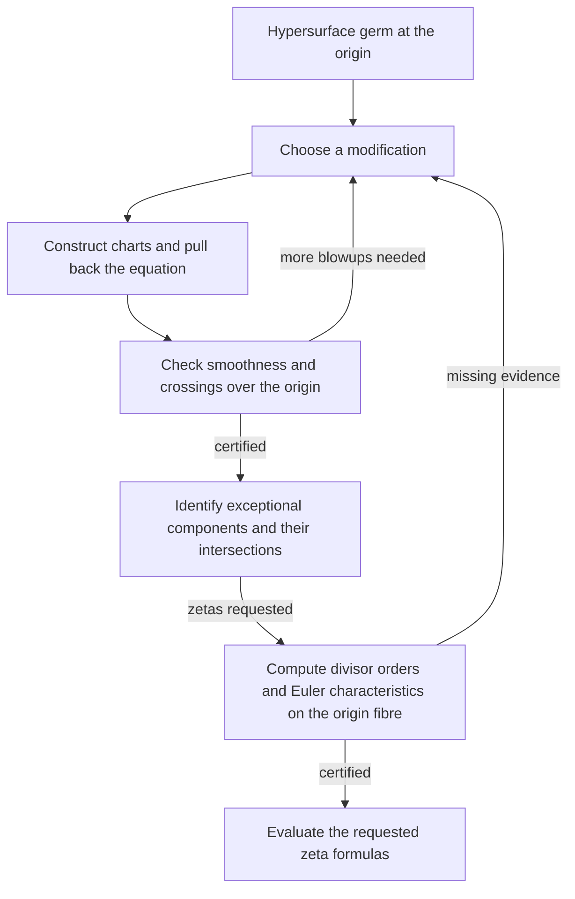

# How Atlas resolves a hypersurface germ

This chapter explains what happens inside `resolve`: how Atlas chooses a
modification, how it builds and checks the charts, and what a saved record
certifies. You do not need it to compute a resolution or its zeta functions.
For that, start with [Resolution, zeta functions and monodromy](../reference/resolution.md).
Read on when you want to know why a resolution has the form it has, why a quick
search ended inconclusive, or exactly what a record proves.

An embedded resolution gives a map under which the hypersurface and the
exceptional divisors have normal crossings over the origin. There are often
several ways to obtain such a map. For example, the plane cusp takes three
ordinary point blowups, while a hypersurface with a suitable Newton polyhedron
can be resolved directly from a fan. After choosing a modification, Atlas
checks the equations on its charts. [Work through the cusp](../tutorial/resolving-a-cusp.md)

This chapter describes `method="auto"`, the default at the prompt, in scripts,
on the command line and over HTTP. Its `charts` field describes the maps, and
its `atlas` field describes the regions used to check them and count
intersections. For a resolution by weighted blowups on quotient charts, use
`method="weighted"`. That method has its own certificate and output fields.
[Resolution records](resolution-records.md) · [Weighted resolution](weighted-resolution.md)

With `method="jung"` (`--method jung`), Atlas skips this choice for a
surface in three variables. It checks the request (intrinsic mode, no zeta
functions) and then runs Jung's method, which verifies its own hypotheses on
the surface before it uses them. [Jung's method](jung-method.md#resolve-with-method-jung) · [Dispatcher](../../engine/resolve.py) · [Jung resolver](../../native/jung.cpp)

## How Atlas chooses a modification

The input consists of a nonzero rational polynomial vanishing at the origin,
the ordered coordinates, and a choice of embedded or intrinsic resolution.
A particular family often admits a short construction. If its hypotheses
fail, the search moves on to a more general method. Any candidate must still
supply the charts and satisfy the checks for the requested mode.

A quick search is inconclusive only when its caller's time is over: the
worker stops it after 55 seconds. Its diagnostic then says so. A bounded
attempt that Atlas makes inside another computation can still end early. Its
diagnostic names a singular tangent direction that made the ordinary blowup
test decline, the outcome of the Newton and successive blowup searches, the
reason the smooth-centre rules gave, and how many candidate certificates the
general search rejected or left undecided.

### Structured inputs

| Geometry of the input | Construction |
| --- | --- |
| Smooth germ, or an embedded divisor already having simple normal crossings | The identity suffices. Atlas recognizes coordinate powers times a unit, and its bounded factorization test recognizes smooth rational branches with independent differentials. For eligible equations in two active coordinates it also verifies two transverse conjugate branches over a quadratic field, including cylinders in up to eight ambient coordinates. [Conjugate plane branches](../../engine/plane_identity.py) |
| Singular plane curve | Blow up points and follow the branches through the new charts until the requested crossings hold. [Plane blowups](../../native/plane.cpp) |
| A-series surface singularity | Try the chain of surface charts before the ordinary-point test. [Surface chains](../../native/chain.cpp) |
| Smooth projectivized tangent cone | Try the ordinary blowup of the origin. [Ordinary points](../../native/ordinary.cpp) |
| Diagonal surface or binomial | Try a fan adapted to the diagonal surface, or coordinate blowups for the binomial. [Diagonal surface fans](../../native/toricfan.cpp) · [Binomial charts](../../native/binomial_fan.cpp) |
| Reduced central arrangement of four to twelve rational planes spanning three coordinates | Blow up the origin. Its exceptional plane carries the projective line arrangement. In embedded mode blow up the strict intersection lines whose directions have at least three incident planes. Intrinsic mode also separates each pair meeting at an ordinary double direction. [Arrangement charts and incidence](../../native/plane_arrangement.cpp) |

A surface can have a diagonal Newton face in nonlinear coordinates. For
`(x+y*z)^2+y^5+z^5`, the solver completes the square and uses the fan of
`X^2+y^5+z^5`. Each displayed chart composes its fan projection with
`x=X-y*z`. The certificate stores the coordinate and its polynomial offset
in `coordinate_translation`. Replay derives the offset again from the input
equation and verifies the projections. A nonlinear offset can include linear
terms, provided it vanishes at the origin. The translation has Jacobian
determinant one, so it preserves the origin fibre and volume orders.
Both surfaces and threefolds can use a nondiagonal
regular fan after this substitution, as for `(x-y*z)^2+y^2*(y^3+z^5)`
and `(x-y*z-t^2)^2+y^3+z^4+t^7`.
On a cyclic surface cover, a square-free decomposition of the ramification
polynomial can also expose a repeated graph `y=h(z)` through the origin.
A bounded substitution straightens this graph before fan verification. Atlas
checks the adapted fan and its intrinsic sections, then composes its chart
maps with the translation to the original coordinates. For an embedded
divisor with repeated factors, Atlas derives the translation from its reduced
support and computes the original factors' orders on those charts. A translated fan's
rays and exponents refer to its adapted coordinates. Its certificate lists
the exceptional boundary images in the input coordinates under
`boundary_image_ideals` and their adapted coordinate ideals under
`adapted_boundary_image_coordinate_ideals`. In older translated archives
`boundary_image_coordinate_ideals` gives the adapted ideals.
[Quadratic candidates](../../native/resolution_candidate.cpp)

A singular direction of the tangent cone rules out the ordinary-point criterion.
For example, $xyz(x+y+z)$ has a singular tangent direction $[1:0:0]$.
One blowup gives an embedded resolution. The four projective lines have
only transverse double intersections, and the exceptional plane supplies the
third transverse component there. [Four-line resolution](https://github.com/pportilla/resolution-zoo/blob/main/records/cone-four-lines.json)

For $xyz(x+y)$, three planes meet along the $z$-axis. After blowing up the
origin, the solver blows up the strict transform of that axis. The three
planes then meet its exceptional divisor at distinct directions.
[Four planes with a triple line](https://github.com/pportilla/resolution-zoo/blob/main/records/cone-d4-quartic.json)

Before committing to point blowups, Atlas classifies the defects on all
orbits of the candidate fan. A curve of defects rules out isolated point
repairs on that fan. For intrinsic resolution, if isolated repairs remain,
the solver first tests whether a regular monomial modification already has
a smooth strict transform with a certified exceptional complex. Repaired
affine charts over rational points retain their certified maps to the parent
Newton charts. These maps let the verifier check the parent and child
projections separately when gluing their exceptional components.

A repair centre can contain several geometric points conjugate over the
rationals. Atlas follows each point through the repair charts and uses those
labels on intersections of exceptional divisors. For the Hesse triangle
with a quartic perturbation this gives one arm of the embedded tree for each
of the three nodes. For the cone over two tangent conics it gives one set
of exceptional divisors over each of their two points of tangency.
When several components have no independent root name, their numbering
uses the verified chart maps, divisor ideals and parent charts. Permuting
the saved affine charts preserves those labels.
[Hesse triangle](https://github.com/pportilla/resolution-zoo/blob/main/records/hesse-triangle-quartic.json) · [Two tangent conics](https://github.com/pportilla/resolution-zoo/blob/main/records/quartic-face-plus.json)

The fast ordinary-point engine accepts two to eight variables, at most 4,096
expanded terms and total degree at most 128. Outside that range a nonzero
linear part can still certify a smooth germ, and the general ideal search
accepts arbitrary finite ambient dimension. After reaching a plane worker limit in
exhaustive search the solver skips the binomial shortcut. For a repeated
input factor, embedded mode can resolve the reduced support and recover the
original multiplicities from its transforms. Intrinsic mode requires a
reduced germ. Atlas checks whether the quotient by the squarefree part is
a unit at the origin, so repeated factors away from the germ are allowed.
The stopping test depends on the mode. For the cusp cylinder
$y^2-x^3=0$ in three-space, one ordinary blowup along the singular line
makes the strict transform smooth. Embedded resolution takes three ordinary
blowups to give the total divisor simple normal crossings.
[Dispatch and size checks](../../engine/resolve.py) · [Binomial charts](../../native/binomial_fan.cpp) · [Recovering multiplicities](../../engine/weighted_record.py)

### Bounded centre proofs

A natural centre to try is the reduced singular locus. Consider
$f=A^2-TB^2$, where $A=x+y+z$, $B=x-y$ and $T=z$. In these linear
coordinates the Jacobian ideal is $(A,TB,B^2)$, whose radical $(A,B)$ defines
a line. Blowing up this line gives two charts.

| Chart | Pullback of $f$ | Strict transform |
| --- | --- | --- |
| $A=Bu$ | $B^2(u^2-T)$ | $u^2=T$ |
| $B=Av$ | $A^2(1-Tv^2)$ | $Tv^2=1$ |

The equations agree on the overlap $uv=1$. In the first chart $B$ is a
coordinate independent of $u,T$, so the smooth strict transform crosses the
exceptional divisor $B=0$ transversely. In the second, $A$ plays the same
role. Compare $(y-x^2)^2-z^5$. Its reduced singular locus is also smooth,
but on the blowup chart $y-x^2=zu$ the strict equation is still the cusp
$u^2=z^3$. Here a further modification is needed. [Centre and chart calculations](../../native/ideal.cpp)

Both search policies can try this construction for inputs in three to eight
variables with four to 128 terms. The reduced Jacobian locus must be a smooth
complete intersection through the origin, of positive dimension and
codimension at least two. Atlas saturates each chart by its pivot before
checking the transforms. An embedded polynomial-graph centre can directly
certify a single exceptional divisor. Other presentations and intrinsic
requests require component analysis. This trial has a 100 ms budget.
[Candidate limits](../../engine/reduced_centre.py) · [Component analysis](../../engine/general_resolution.py)

Exhaustive search also tries two cheaper embedded proofs first. A small fan
may certify the first monomial ideal candidate. For a pencil $H(x,y)+zK(x,y)$
of binary homogeneous forms of equal degree 2–15, the second shortcut applies
when $H$ is a multiple of a power of a noncoordinate rational linear form
and $K$ is nonzero at its projective root. After ruling out the preceding
Newton candidates, the verifier tests the identity, origin and coordinate-line
centres in order. The shortcut succeeds when only the third centre works.
[Bounded trials](../../engine/newton_trials.py) · [Pencil test](../../native/resolution_candidate.cpp)

### Quick search

Use `--quick` to give the search 55 seconds: the worker of a quick request
stops then. Inside that time the search does not give up. It ends with a
certified answer, or when the time is over, and only then is the result
inconclusive (exit code 3). The limits on the size of the input remain.

The search first tries the fast methods, each within a budget: an eligible
regular Newton modification, including available coordinate changes and
repairs of failed crossings (20 seconds), and in four to eight variables the
repeated-tangent rule. When they do not apply or decline, the smooth-centre
rules described below are the safe method, in three to eight variables. They
have no deadline of their own and no budget of charts or stages. The rules
take turns of 10, 20, 40, … seconds, and each continues from the blowup it
had reached, so no rule loses its work and none can keep the others waiting
for ever. A rule leaves only when it stops for a reason of its own. The last
one left runs without turns. Such a reason is a defect of the rule: it is
kept in `diagnostic.canonical_reason` and in the progress of the request.
The search then continues with projective ideal blowups, as an exhaustive
search does, which returns only with a certificate.

The same holds for the outputs. A resolved record whose dual complex is
partial, or which lacks a requested zeta function, is not the answer of a
quick search: the search continues as above. In intrinsic mode the
smooth-centre rules first go on to total normal crossings, which gives the
exceptional complex on the smooth strict transform.

When the verifier rejects the charts that a faster method proposed, the
smooth-centre rules make their own proposal, whose charts are verified in
the same way. Verifying a proposal replays its blowups, which can take
longer than constructing them, so the first verification must finish while
25 seconds of the worker's limit remain, and then the smooth-centre rules
take over. Once no such time is left, a verification runs to its end.
[Newton modifications](../../engine/newton_backend.py) · [Origin blowups](../../engine/origin_backend.py) · [Quick fallback](../../engine/resolve.py) · [Ideal search](../../engine/general_resolution.py)

Atlas also solves smaller problems inside a computation, such as the zeta
function of a transverse germ for a nearby stratum. These are bounded
attempts (`bounded` in the request): each method keeps its budget, the
smooth-centre rules get the rest of the worker's limit less 7 seconds, and
the attempt may return inconclusive.

### Exhaustive search

The CLI and session default to exhaustive search. Atlas increases the time
available to an undecided candidate and retries it. On eligible singular
inputs in three to eight variables it can search for a Newton modification,
point blowups and an ideal blowup concurrently. In the usual schedule Newton
has a two-second head start. Its verified chart data can be reused directly.
At an isolated singular point the point blowups start with the complete rule,
and a separate worker runs the maximal order rule alone. The complete rule
keeps its answer when it arrives in time. A record from the order worker
waits until the complete rule's worker has run three times as long as the
order worker took, and at least five seconds. Answers from the other
methods are taken as before. [Smooth-centre rules](#where-the-resolution-decisions-run)
Outside the parallel case, eligible inputs try Newton before general ideal
enumeration. HTTP requests that omit a policy first try quick search and may
return a background exhaustive job. [Search schedule](../../engine/resolution_search.py) · [HTTP policy](../../engine/app.py)

For an unattended ordinary resolution, run for example
`./atlas resolve 'x^2+y^2+z^3+t^2*z^2' --vars x,y,z,t --mode intrinsic --exhaustive --json`.
The whole search has no wall-clock deadline. It continues until it certifies
the requested outputs, you interrupt it with Ctrl-C, or an unrecoverable
execution error stops the search.
A smooth strict transform can still have a partially determined exceptional
dual complex. An ordinary exhaustive geometry request continues searching
in that case. A zetas-only request can finish once it has the requested
zeta data. Replaying a saved dual complex checks the particular modification
in that record. [Termination conditions](#what-the-exhaustive-search-can-certify)

One tangent-cone test changes this order. Suppose an embedded ternary input
has a higher-order term and initial form $cL^d$, with $d\ge2$ and all three
coefficients of $L$ nonzero. Its axial intercepts all have degree $d$. In
the coordinate choices available to this search the Newton modification is
the ordinary origin blowup. The exceptional plane meets the strict transform
along a repeated line whose intersection with the dense torus is a curve.
Newton's finite-point repair cannot resolve that curve. For degree at most
16, at most 128 terms and 64-bit rational numerators and denominators, Atlas
can detect this case and start origin blowups immediately. Ideal certification
joins on failure or after 250 ms. [Tangent test](../../native/resolution_candidate.cpp) · [Newton repair](../../engine/newton_repair.py)

### Workers and deadlines

Each solve runs in its own process so that a deadline or interruption can
stop it. On Linux, interactive and HTTP sessions can fork workers from a
preloaded engine. A one-shot CLI solve starts an interpreter. If no fork
server is available, a single-threaded CPU solver can fork its own search
workers. Each starts with fresh verification state. Changed engine sources,
changes to startup-only settings, or multithreading can require a fresh
interpreter. Helper programs for plane curves, fans and graph charts use the
same deadlines in forked mode. [Fork server](../../engine/fork_server.py) · [Native helper processes](../../engine/native_process.py)

A rule's deadline also reaches the exact computations inside a native centre
choice. A Gröbner basis, its modular lifting and its verification stop within
milliseconds of the deadline, and the rule gives up so that the next rule can
start. Before, one such computation could overrun a 7-second share by
14 seconds. The radical and the prime components of a locus of maximal order
stop in the same way: for the twenty planes where three of
$xyztu(x+y+z+t+u)=0$ meet, that decomposition alone ran for two minutes.
[Kernel deadlines](../../native/KERNEL.md#deadlines)

When enough processors are available the other workers may start alongside
Newton, holding their answers until its head start ends. Otherwise a forked
worker receives its candidate when its turn begins. A parallel certificate
search preloads one verifier and starts a spare if a proof is undecided or
times out. [Exhaustive worker coordination](../../engine/exhaustive_resolution.py)

## Constructing and verifying charts

For a **Newton modification**, each maximal cone of a regular fan gives an
affine chart. The rays specify a monomial substitution. Removing the
exceptional monomial from the pullback gives the strict-transform equation.
[Newton chart construction](../../engine/newton_backend.py)

An embedded divisor with several rational factors through the origin can
have normal crossings although the union of their strict transforms is
singular. Take `y*(x^2+x*z+y^3)`. The plane $y=0$ meets the $A_2$ surface
in two lines. On a chart whose cone contains the axis ray $e_y$, the factor
$y$ becomes the toric boundary coordinate of that ray. When the verifier
finds crossings failing for the strict transform as a single component, it
checks each rational factor as a separate branch S1, S2, … with its own
multiplicity. The saved-record verifier accepts the same branches.
[Branch verification](../../engine/monomial_atlas.py)

For a **smooth blowup**, each chart uses one generator of the centre as a
pivot. The new coordinates include the ratios of the remaining generators
to this one, as in the line example above. For a general **ideal blowup**,
the verifier saturates these graph equations by the pivot to recover the
closure of the graph away from the exceptional divisor. Adding the pulled-back
hypersurface equation and saturating again gives the strict transform.
Comparing the boundary components on overlaps determines which local pieces
glue. [Smooth centres](../../engine/local_blowups.py) · [Graph charts](../../engine/graph_record.py) · [Boundary gluing](../../engine/general_resolution.py)

### Where the resolution decisions run

For canonical point and curve blowups, Atlas uses the invariant of Bierstone
and Milman to choose a smooth centre while the strict transform is singular.
On eligible affine hypersurface charts it computes the invariant and centre
by successive restriction to hypersurfaces of maximal contact. In embedded mode, when a surface
in a threefold has become smooth, the curves cut out on it by the exceptional
divisors determine the remaining blowups. [Bierstone and Milman, *Desingularization algorithms I. Role of exceptional divisors*, Theorem 1.14 (2003)](https://arxiv.org/abs/math/0207098) · [Centre calculation](../../native/centre_affine_maximum.cpp) · [Surface step](../../native/surface_centre_choice.cpp)

For `x^5+(y^2-z^3)^2`, two boundary curves of multiplicity two cross on
the smooth strict surface. Blowing up their intersection point creates a
new curve of multiplicity three and can repeat the tie. Here a second
exceptional divisor distinguishes one branch. The solver verifies that the
intersection of the two exceptional divisors lies on the strict surface,
then blows up that smooth curve. The resulting record identifies this step
as a `shared boundary curve`. [Centre verification](../../native/surface_centre_choice.cpp)

Intrinsic mode can stop as soon as the strict transform is smooth on all
charts over the origin. For example, take $A=x+y+z$ and $B=x-y$ in the
sheared cusp cylinder $A^2-B^3=0$. Atlas finds the line $A=B=0$. Its
blowup gives strict equations $v^2-B=0$ and $1-Au^3=0$, both smooth.
The former is tangent to the exceptional divisor at $B=v=0$. This explains
why the intrinsic record has one blowup and the embedded record has three.
[Canonical construction](../../engine/origin_backend.py) · [Incidence replay](../../engine/canonical_replay.py)

Some germs have a curve or surface of singular points through the origin,
and on these the invariant can be slow or find no hypersurface of maximal
contact. A **maximal order rule** therefore works beside the complete rule,
from the original germ. In a quick search the two take turns, as described
under [Quick search](#quick-search). In a bounded attempt the complete rule
keeps 60% of the remaining time and the maximal order rule follows. A rule
stopped at its share keeps its charts. When the rules after it give up
before the deadline, it continues from the stage it had reached, and the
rule that completed a blowup most recently goes first.
An exhaustive search has no deadline to share, so there the
maximal order rule races in a worker of its own. It can also be the faster
rule at an isolated point: for
`x^9+x^4*y*z+1/8*x^3*y^3-3/2*x^3*z^2-1/32*x*y^4+1/2*x*y*z^2+y^2*z^2-z^3`
the complete rule stalls in its first centre choice, while the maximal order
rule resolves the germ with 13 blowups. [Order worker](#exhaustive-search) While
the strict transform is singular at a point where crossings fail, it blows
up the reduced locus where the order of the strict transform is largest.
This locus is taken in the whole chart, so a singular curve that leaves the
fibre is blown up whole. Only components that meet a point owned by the
chart are kept, and only those of the largest dimension across the charts.
If the locus is singular, a previous exceptional divisor can distinguish
a smooth union of its components across all charts. Otherwise the rule
descends to the singular locus. On a smooth proposed centre, the rule
restricts each exceptional divisor to the components of the centre it does
not contain and tests those traces for normal crossings. A tangency or an
intersection of excessive dimension gives a smaller locus to treat first.
A smooth centre inside the locus of maximal order
does not raise the order. Once the strict transform is smooth at those
points, the invariant continues, with the existing divisors treated as
given ones. For `x*y^4+z^2+t^2` the rule blows up the singular $x$-axis
twice. The first entry of the invariant comes from the same native
calculation. [Order locus](../../native/centre_maximum.cpp) · [Maximal order rule](../../engine/local_blowups.py)

An embedded resolution asks for normal crossings of the total transform,
and smooth branches that cross normally already have them. In embedded mode
the blowups therefore carry each factor of the equation over $\mathbb Q$ as
a component S1, S2, … of its own, and stop when these and the exceptional
divisors cross normally. For the six hyperplanes $xyztu(x+y+z+t+u)=0$ the
blowup of the origin is enough: on its exceptional $\mathbb P^4$ the
hyperplanes are in general position. A factor that splits over
$\overline{\mathbb Q}$ stays one component, which must become smooth, so its
conjugate branches still come apart. Intrinsic mode asks for a smooth strict
transform and keeps the whole hypersurface as one component: there every
pair of branches has to be separated. A record made with separate components
says so in `certificate.strict_components`, and its replay derives the same
factors from the equation. [Components](../../engine/origin_backend.py)

The components of a smooth centre can lie on different earlier divisors, so
that the new exceptional divisor gets different data $(N,\nu)$ on them. A
curve centre is first divided by the divisor that contains part of it. The
side that meets a point owned by some chart is blown up first: blowing up a
side that meets no owned point changes nothing, and the same centre would
return. When no divisor separates the parts, each prime component over
$\mathbb Q$ gives its new divisor one value of $(N,\nu)$. Conjugate points
and the generic point of a curve have the same orders. The components with
the largest value are blown up first. Disjoint centres blown up at
successive stages give the same space. [Split rules](../../native/centre_weights.cpp)

A chart that has been blown up stays for its points off the centre. Later
the prime components of a smooth centre can meet in such a chart, inside a
centre already removed from it. For $xyztu(x+y)$ the planes where three
hyperplanes meet do so in the first chart of the origin blowup, along the
lines blown up before. Their union is singular there, and its blowup in
that chart has no uniform orders. The components are then blown up one by
one: near the points of one component that the chart owns, this is the
blowup of the whole centre. The other components join the centres removed
from the new charts. Components that meet outside the removed centres are
refused. [Blowup stage](../../native/canonical_blowup.cpp)

When a finite centre must be split, the exceptional divisors through a
point can identify its class across charts. If several points have the
same divisor labels, the routine can select a single local factor only
when one chart contains all the candidates. An ordering of slopes on one
chart need not agree with the ordering on an overlapping chart, where the
coordinate may be the reciprocal slope. An ambiguous selection returns
control to the other resolution rules. [Finite centre selection](../../native/centre_weights.cpp)

| Charts | What the native verifier checks |
| --- | --- |
| Canonical blowups | Each stage computes strict transforms, exceptional orders and charts. It checks which new charts meet the fibre and where crossings still fail. For intersections it uses the exceptional ideals, equations of the fibre, and exclusions on each chart. [Blowup stage](../../native/canonical_blowup.cpp) · [Chart incidence](../../native/owned_chart_incidence.cpp) |
| Ideal blowups | The graph equations give the strict transform, projection and exceptional orders. Decomposition over the rationals or a marked number field, followed by comparison on overlaps, identifies the geometric components. [Graph verification](../../native/graph_replay.cpp) · [Wide inputs](../../native/graph_wide.cpp) · [Component projections](../../native/component_projection.cpp) |
| Newton charts | The fan verifier checks exceptional ray images against the singular locus of the reduced source, then verifies substitutions, pullbacks, face domains and crossings. Torus sections give incidence and the faces of each cell. On a degenerate stratum the saturated Jacobian and a finite-locus test guide the repair. [Ray images](../../engine/fan_centres.py) · [Fan verification](../../native/fan_verification.cpp) · [Torus sections](../../native/torus_sections.cpp) · [Newton repair](../../native/newton_repair.cpp) |
| Saved charts | The verifier recovers the projection, chart domains and exceptional ideals from the saved equations, then glues components and computes the requested invariants. [Projection coefficients](../../native/projection_coefficients.hpp) · [Gluing](../../native/chart_gluing.cpp) |

For chain and loop singularities, a regular monomial modification can have a
whole torus orbit in the smooth strict transform. Atlas checks the chart
equations and embedded crossings before using this case for intrinsic
incidence. On each exceptional intersection it identifies both the closures
of the torus factors and the coordinate divisors contained in the strict
transform. Their chart ideals and common faces determine the intrinsic dual
complex. [Toric sections](../../native/torus_sections.cpp) · [Surface gluing](../../native/fan_surface.cpp)

For $x^2y+y^3z+z^2t+t^3$, an adapted Newton chart requires further
blowups and expensive component factorization. The intrinsic search
compares it with a regular monomial fan before gluing the repaired
charts. In this example the monomial fan certifies 41 exceptional
components directly. [Candidate selection](../../engine/newton_backend.py) · [Threefold regression](../../tests/test_newton_singular_centres.py)

## What the record certifies

Two affine charts of one blowup overlap. For instance, the two charts of a
plane point blowup both contain all nonzero finite slopes of its exceptional
line. To count that line once, one chart can take all finite slopes and the
other the single missing point. The `atlas` field makes such assignments
precise. Each piece specifies its projection, ambient equations, components,
origin fibre and the region and exclusions it owns.

For a projective ideal blowup, the generators and their full set of standard
opens determine a proper map. Atlas tests that the centre lies in the
singular locus of the reduced support. The map is an isomorphism away from
the centre, hence birational on each component of the reduced hypersurface.
Saturating the pullback on each open recovers its strict transform. Once the
required smoothness or crossing checks hold over the whole origin fibre,
properness gives a neighbourhood of the origin on which they still hold.
Indeed, the image of the closed locus where a check fails is closed and
misses the origin. [Graph verification](../../native/graph_replay.cpp) · [Graph opens](../../engine/graph_record.py)

An identity, plane, ideal-blowup, point or fan chart can have a dedicated
verifier. A monomial construction can also supply its verified atlas directly.
When these routes decline, Atlas reconstructs the charts and performs the
general checks. [Monomial constructions](../../native/monomial_resolution.cpp) · [Verifier selection](../../engine/strata.py) · [General chart checks](../../engine/atlas.py)

To compare divisor pieces on affine charts, Atlas equates their original coordinates and saturates away from the exceptional divisors to obtain the closure of the overlap. From this graph it can recover the rational coordinate changes in both directions. Two pieces glue when these changes are regular at their generic points, carry each generic point to the other, and respect the loci removed from both charts. A meeting confined to a smaller closed subset therefore leaves the components distinct. [Overlap construction](../../engine/atlas_gluing.py) · [Native coordinate comparisons](../../native/primary_decomposition.cpp)

Embedded mode verifies normal crossings of the total transform on the owned fibre and computes incidence for ambient exceptional divisors. Intrinsic mode verifies the smooth strict transform and computes incidence on that transform. If an intrinsic atlas cannot supply embedded strata for the requested zetas, Atlas resolves the same polynomial in embedded mode and can store the verified `embedded_companion.atlas`. [Mode and companion handling](../../engine/resolve.py) · [Chart conventions](resolution-records.md#chart-and-complex-conventions)

Both zetas use the same compactly supported Euler characteristics of disjoint strata. A’Campo’s formula uses the open strata on individual components and their multiplicities. The topological zeta function uses all strata, their multiplicities and the orders of the pulled-back volume form. [Native monodromy](../../native/monodromy.cpp) · [Native topological zeta](../../native/zeta.cpp) · [Formulas and cusp values](zeta-functions.md#the-monodromy-zeta-function)

### What the exhaustive search can certify

The ordinary problem takes a nonzero polynomial over $\mathbb Q$ vanishing at
the coordinate origin. Embedded resolution retains the multiplicities of the
original divisor. A sequence of smooth blowups resolving its reduced support
exists in characteristic zero. Over affine space a finite composition of
blowups is itself the blowup of one finitely generated ideal. These facts
explain why Atlas searches projective ideal blowups when a plane, Newton or
canonical proposal is insufficient. [Bierstone and Milman](https://arxiv.org/abs/alg-geom/9508005) · [Stacks Project, Lemma 080B](https://stacks.math.columbia.edu/tag/080B)

To see why finite descriptions suffice, choose such a resolution over
$\mathbb Q$. Write generators of its blowup ideal as $g_0,\ldots,g_r$.
Their graph embeds the blowup in $\mathbb A^n\times\mathbb P^r$, with one
standard affine chart for each projective coordinate. The closures of its
exceptional components have finitely generated ideals homogeneous in those
coordinates. There are finitely many geometric components of their
intersections. All coefficients needed to describe them over
$\overline{\mathbb Q}$ lie in one finite number field. The search format admits
rational centre generators, a minimal polynomial for a primitive field
element, and homogeneous boundary generators over that field.
[Certificate encoding](../../engine/resolution_search.py) · [Chart predicates](../../native/resolution-algorithms.md#charts-of-a-blowup-and-the-verification-of-a-centre)

The search interleaves new finite ideal and boundary descriptions with
revisits to earlier descriptions. It tries deeper algebraic tests and also
repeats each fixed effort with increasing wall time. Coupling both limits
would allow the test to grow more expensive on every retry before reaching
the certificate. A timeout leaves a candidate eligible for another attempt.
In both modes the general search checks the requested geometry and incidence
inside the timed attempt before accepting an ideal. When an
embedded solve requests zetas, the general verifier also checks the chart
ownership, divisor orders, and strata over the original fibre. It also tests
$Z_{\mathrm{top},0}(0)=1$ before accepting the integral data. A quick search
stops at its requested budget. An exhaustive solve continues looking for
the missing evidence. [Candidate schedule](../../engine/resolution_search.py) · [Acceptance checks](../../engine/general_resolution.py)

For example, for $f=x_1\cdots x_9$ the identity resolves a simple
normal-crossings divisor. Only the ninefold intersection meets the origin
fibre, contributing $Z_{\mathrm{top},0}(s)=(s+1)^{-9}$. All the individual
open strata miss that fibre, so the alternating monodromy zeta is $1$.
The eigenvalue required by the pole at $-1$ occurs on $H^0$ of the Milnor
fibre. Atlas also records it on each nearby smooth component.

Some sparse inputs have exponents larger than a machine word. If the fast
rational factorizer declines, the native kernel can certify a factor using
Eisenstein's criterion or enumerate primitive integer divisors within a
finite Kronecker coefficient bound and check exact division. For a gcd the
intersection of the two principal ideals gives their least common multiple
and hence their gcd. These fallbacks let an exact calculation continue even
when a packed representation cannot hold an exponent. [Rational factor search](../../native/rational_factor_fallback.cpp) · [GCD kernel](../../native/polynomial_gcd.cpp)

Given the certified strata, their Euler characteristics are computable by
projection one coordinate at a time. On each constructible piece of the
base, polynomial gcd calculations give the number of distinct roots in a
finite fibre or identify an affine-line fibre. Additivity then reduces the
calculation to fewer coordinates. The points lying on exactly a set $J$ of
components are counted from closed strata. By additivity their Euler
characteristic is the alternating sum, over the sets $K\supseteq J$ with a
common point, of that of the common points of the components of $K$. A
closed stratum is counted with no component left out, which matters when
several components are not coordinates of the chart: on the origin blowup of
seven hyperplanes in general position in $\mathbb C^5$ each chart has two
such planes, and the sum takes a twentieth of a second. A’Campo's product
and the Denef–Loeser sum are exact finite arithmetic once these counts are
known. [Euler kernel](../../native/euler.cpp) · [Strata](../../native/ideal.cpp) · [Denef and Loeser](https://webusers.imj-prg.fr/~francois.loeser/jams92.pdf)

With terminating exact tests for chart regularity, geometric components,
their gluing and divisor orders, the theoretical algorithm eventually
reaches a finite certificate, finishes its verification, and evaluates
both functions. For the compiled kernels this argument is conditional on
their ability to verify at least one such presentation for every accepted
input. A universal proof of that condition remains open in this audit,
particularly for number-field decompositions and chart gluing.
Worker failures and exhaustion of physical memory remain possible. The
dispatch order favours inexpensive proofs on recognized inputs. There is
no established guarantee that it minimizes runtime or the number of blowups
across all inputs.

In Atlas's sign convention, the cyclotomic exponent for a reduced pole
denominator $q$ at a point $a$ of the original divisor is given by

$$
C_q(a)=-\sum_{q\mid N_i}\chi_c(E_i^\circ\cap\pi^{-1}(a)).
$$

A nonzero value on a stratum whose closure contains the origin witnesses
the required eigenvalue nearby. A zero at the origin leaves open the
possibility of cancellation there or a witness on another stratum. Atlas
checks the origin and selected nearby strata for geometric witnesses. In
quick mode, both zetas can have status `computed` while the conjecture
check has status `unresolved`. In exhaustive mode each outstanding pole
passes to the local Bernstein–Sato root test. Given the certified poles,
this finite algebraic test decides the weak local monodromy conjecture
for the input germ, including eigenvalues on strata omitted by the geometric
search. The resolution termination qualification above concerns the earlier
step of obtaining those poles.
[Local eigenvalue decision](../../native/resolution-algorithms.md#deciding-nearby-monodromy-eigenvalues-for-a-pole) ·
[Nearby witnesses](zeta-functions.md#monodromy-near-the-origin) · [Denef, Lemma 4.6](https://www.numdam.org/item/CM_1993__89_2_207_0.pdf#page=9)

## Replaying a saved resolution

Zeta replay verifies the saved geometric evidence against the defining
equation, including the ordinary embedded companion when present. If an
older record lacks reconstructible ownership, Atlas computes the selected
zetas again from the equation. A recorded contradiction is a certificate
error. The `recompute-dual-complex` command recomputes incidence in the
saved mode. For canonical records it replays the centres and chart family.
For a repaired Newton record it checks the parent substitutions and strict
equations against the input and verifies that the replacement opens cover the
failed region. An older atlas whose map or cover cannot be reconstructed
can yield partial incidence. [Replay a saved cusp](resolution-records.md#save-and-replay-the-cusp) · [Incidence replay](../../engine/resolution_complex.py) · [Zeta replay](../../engine/resolution_zetas.py)
